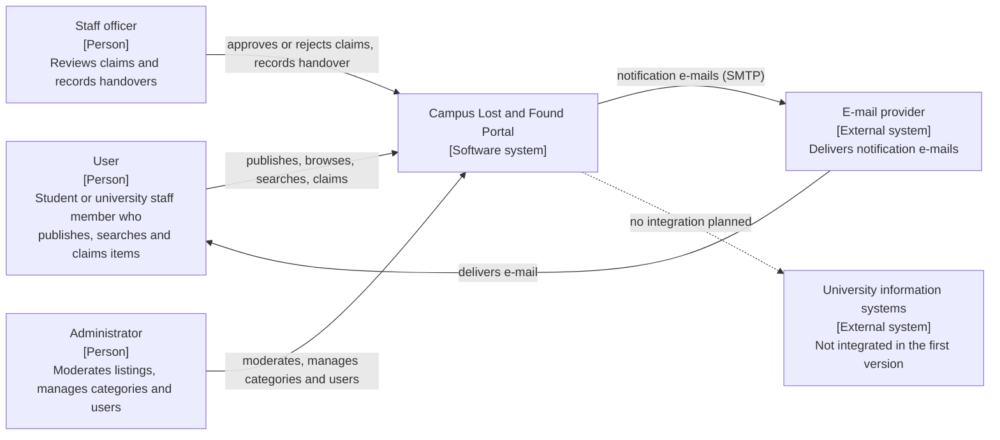
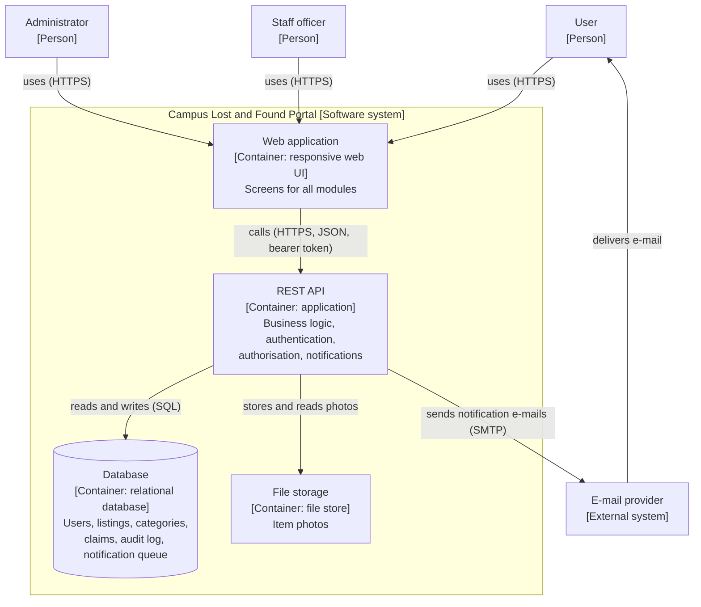

# C4 Model – Level 1 (System Context) and Level 2 (Containers)

**Project:** Campus Lost and Found Portal | **Team:** Team 24
**Owner:** Aslıhan Kaçmaz (K3, Architect) | **Sprint:** 2 | **Status:** Draft for review
**Consistent with:** `docs/system-context-diagram.md` (updated in the same sprint), `docs/architecture/adr.md`, `api/openapi.yaml`. Level 3 diagrams of each module are in `docs/architecture/mX-uml.md`.

Diagrams are Mermaid flowcharts that follow the C4 notation (person, software system, container, external system).

## 1. Level 1 – System Context

| Element | Type | Description |
|---|---|---|
| User | Person | Registered student or university staff member. Browsing is public, publishing and claiming require login. |
| Staff officer | Person | Person with the staff role who reviews claims and records handovers (module M5). |
| Administrator | Person | Person with the admin role who moderates inappropriate listings, manages categories and users (module M5). |
| Campus Lost and Found Portal | Software system | The system described in this repository. |
| E-mail provider | External system | Sends e-mails for claim results and listing status changes (module M3). |
| University information systems | External system | Explicitly not integrated (Proposal 5.1 and 6.2). |

## 2. Level 2 – Containers

| Container | Responsibility | Technology | Decision |
|---|---|---|---|
| Web application | Responsive screens for all modules (list, search, detail, claim, staff and admin screens) | Not decided yet, runs in the browser | ADR-001 |
| REST API | Implements `api/openapi.yaml`, validates requests, checks roles, creates and queues notifications | Not decided yet, layered (controller, service, repository) | ADR-001, ADR-002 |
| Database | Stores users, listings, categories, claims, audit log and notification queue | Relational database | ADR-001 |
| File storage | Stores item photos (JPEG or PNG, at most 5 MB); the database holds only `photoUrl` | File store, size limit enforced by the API | ADR-003 |
| E-mail provider | Delivers e-mails sent by the API | External SMTP service | ADR-004 |

## 3. Differences from the Sprint 1 context diagram

The Sprint 1 diagram showed file storage as an external node and listed e-mail notifications as out of scope. Because of the Sprint 2 module plan (M3 notifications) and to match the Vision document, the updated `docs/system-context-diagram.md` now:

- shows the **e-mail provider** as an external system,
- treats **file storage as a container inside the system boundary** (Level 2), not as an external system,
- names the person roles **User, Staff officer and Administrator**,
- keeps university information systems as "not integrated".

## 4. Open points

- Programming language and framework are not decided. This is the next architecture decision (ADR-005) and must be made before Sprint 3 starts.
- Role names in the OpenAPI draft (STUDENT, STAFF, MODERATOR) must be aligned with User, Staff officer and Administrator.
