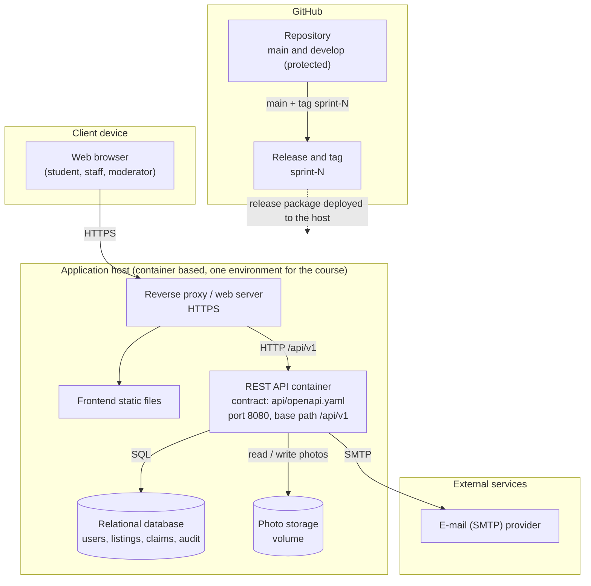

# Deployment Diagram

**Owner:** Berra Bayındır (DevOps Engineer)  
**Status:** Target deployment for the Campus Lost and Found Portal. Sprint 2 is a documentation sprint; no deployment exists yet. The diagram must stay consistent with the C4 Level 2 container view (`docs/architecture/c4-context-container.md`) and the architecture decisions (ADR) of the Architect. Technology names are intentionally generic until the ADRs are final.

---

## 1. Deployment Diagram (Mermaid)

---

## 2. Nodes

| Node | Responsibility | Notes |
|---|---|---|
| Web browser | Runs the user interface | Chrome, Edge, Firefox and mobile browsers (see NFR-M3-03) |
| Reverse proxy / web server | Terminates HTTPS, serves frontend, forwards `/api/v1` to the API | Only public entry point |
| Frontend static files | UI screens designed in Figma | Built from the repository |
| REST API container | Implements `api/openapi.yaml` | Base URL in the draft: `http://localhost:8080/api/v1` (local development) |
| Relational database | Stores users, listings, claims, handover and audit records | Not reachable from outside the host |
| Photo storage | Stores listing photos (JPG/PNG, size limit from FR-M2) | Volume mounted into the API container |
| E-mail provider | Sends notifications | External dependency, replaced by a stub in tests |

## 3. Environments

| Environment | Purpose | Source |
|---|---|---|
| Local development | Each developer runs API and database on their own computer | `develop` branch |
| Release | Version that is assessed | `main` branch, tag `sprint-N` (for this sprint: `sprint-2`) |

## 4. Release Flow

1. Work is done on `feature/<issue-no>-<name>` branches and merged into `develop` through reviewed pull requests.
2. At the end of a sprint `develop` is merged into `main` through a pull request.
3. The merge commit on `main` is tagged `sprint-N` and a GitHub Release is created from the tag.
4. `main` and `develop` are protected: no direct push, at least one approving review.
