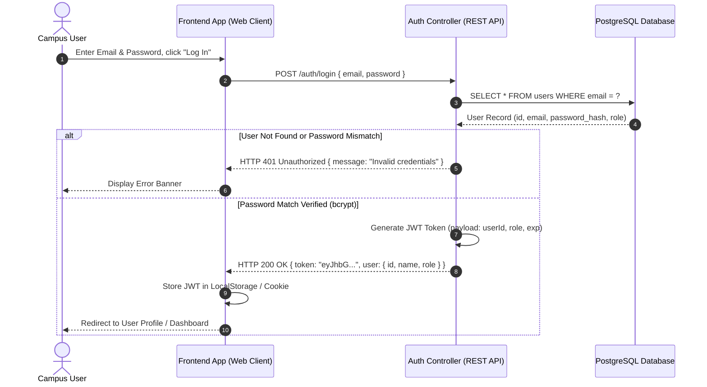
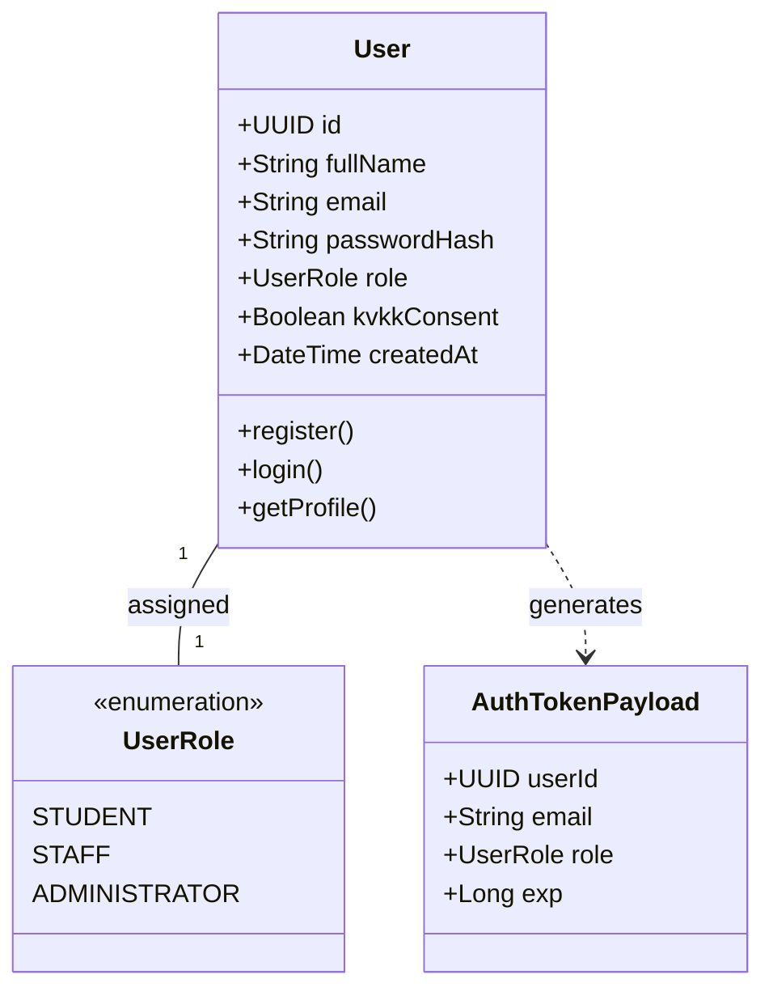
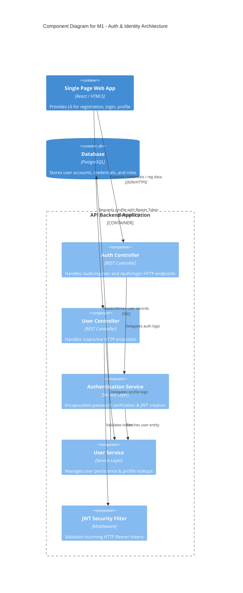

# Module 1 (M1) — Architecture & UML Specifications

**Module Owner:** İrem Köse (K1 — Product Owner)

**Scope:** Sequence Diagram, Class Diagram, and C4 Level 3 Component Diagram for Authentication & User Management.

## 1. Sequence Diagram: User Authentication (Login Flow)



## 2. Class Diagram: User and Role Domain Model



## 3. C4 Level 3 Component Diagram: Auth & Identity Component



## Database ER Diagram (M1)
 
```mermaid
erDiagram
    USERS {
        string id PK
        string full_name
        string email UK
        string phone_number
        string password_hash
        string role
        boolean kvkk_accepted
        string kvkk_accepted_at
        string created_at
        string updated_at
    }
 
    USER_SESSIONS {
        string session_id PK
        string user_id FK
        string token_jti UK
        string expires_at
        string revoked_at
        string created_at
    }
 
    USERS ||--o{ USER_SESSIONS : "has active or past sessions"
 ```
