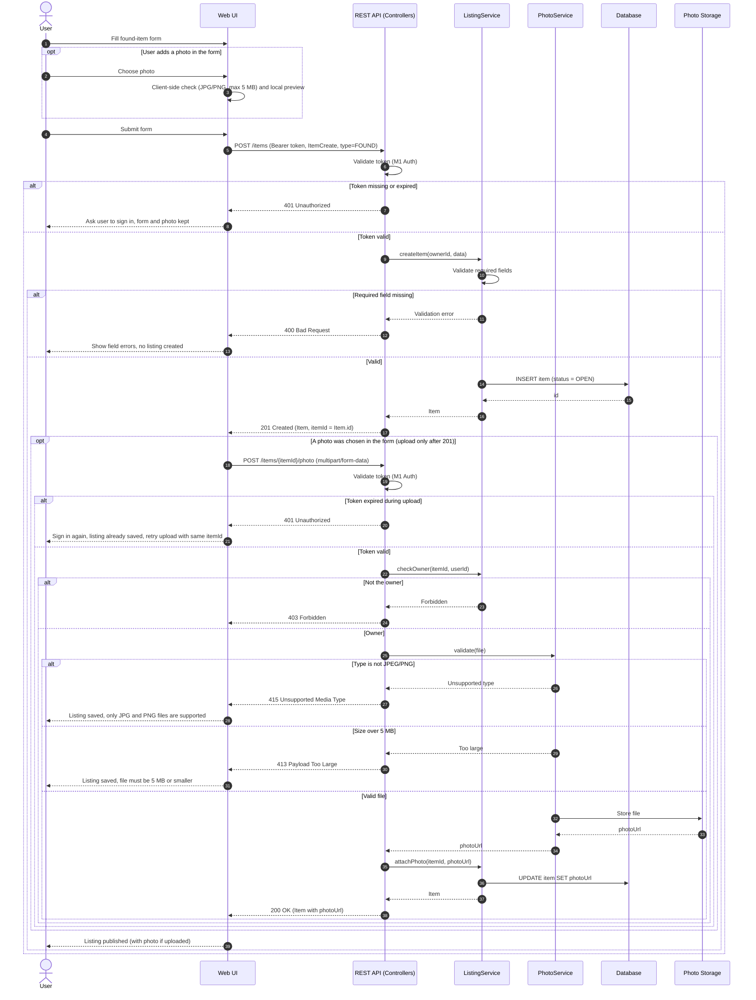
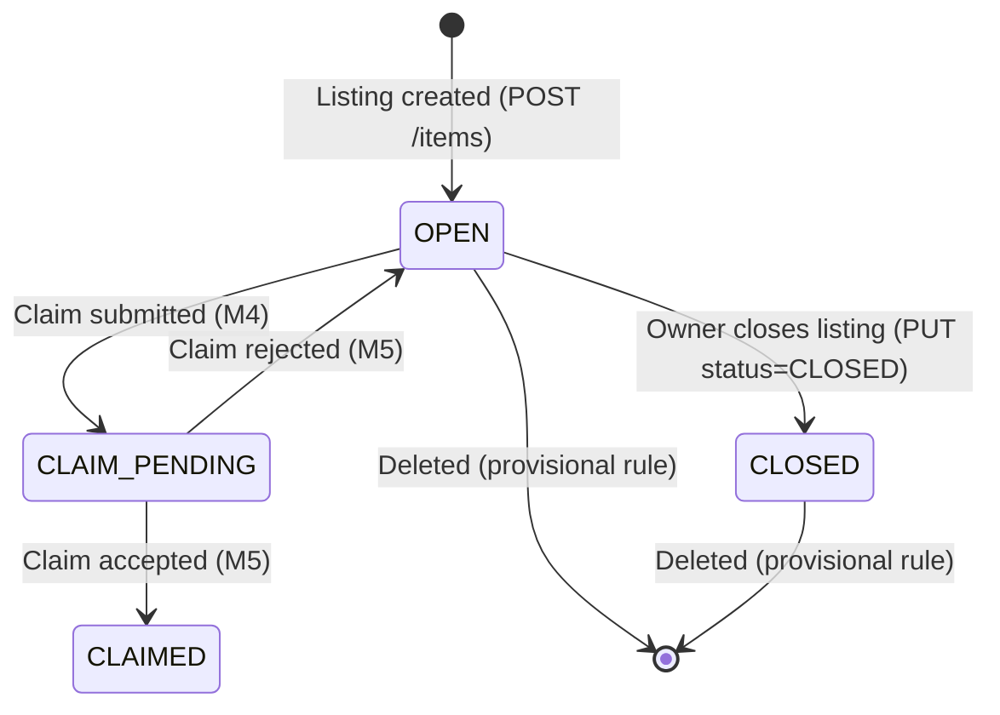
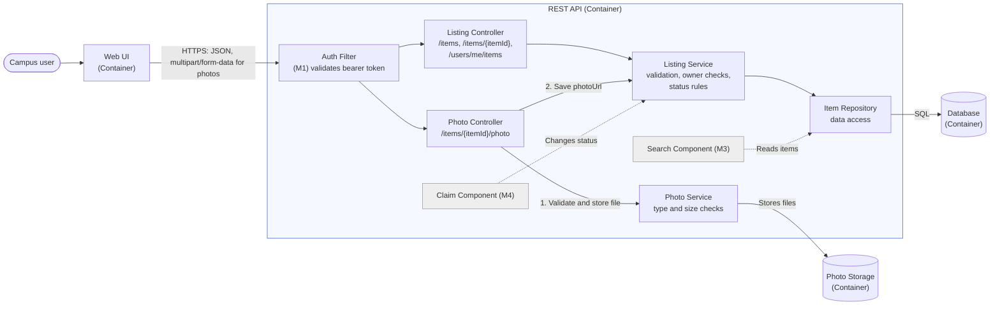

# Architecture M2 - Listing Management

**Module owner:** Tugba Kezban Cay (tugbacay21)  
**Related:** `docs/srs/m2-listings.md`, `docs/nfr/m2.md`, `api/openapi.yaml`, `docs/architecture/c4-context-container.md`  
**Related issue:** #50  
**Status:** Draft for team review

This document contains the M2 parts of the architecture: a sequence diagram for creating a listing and uploading a photo, a state diagram for the listing status (`ItemStatus`), and the C4 Level 3 (component) view of the listing part of the REST API. All diagrams use Mermaid.

## 1. Sequence Diagram - Create Listing and Upload Photo (UC-M2-02)

Covers FR-M2-02 and FR-M2-06. The listing is created first (`POST /items`). The user may choose a photo while filling in the form (client-side check and local preview, same as the user flow), but the upload (`POST /items/{itemId}/photo`) is sent only after `201 Created`, because it needs the new listing id (`itemId` = `id` in the `201` response). A failed upload does not lose the listing (UC-M2-02, A4). The Photo Service only stores the file; the Listing Service writes the returned `photoUrl` to the item.

## 2. State Diagram - Listing Status (`ItemStatus`)

Values are taken exactly from `ItemStatus` in `api/openapi.yaml`: `OPEN`, `CLAIM_PENDING`, `CLAIMED`, `CLOSED`. The listing type (`LOST` / `FOUND`) is a separate field (`ItemType`) and does not change.

> **Provisional:** OpenAPI already defines **who** may delete a listing (the owner or a moderator, `204`). It does **not** define **in which statuses** deletion is allowed - that is a team decision with M4/M5. Until it is decided, deletion is drawn only from `OPEN` and `CLOSED`; no delete transition is drawn from `CLAIM_PENDING` or `CLAIMED`.

| Transition | Who | Module | Rule |
| --- | --- | --- | --- |
| `[*] → OPEN` | Listing owner | M2 | Every new listing starts as `OPEN`. |
| `OPEN → CLOSED` | Listing owner | M2 | FR-M2-04. Only from `OPEN`; rejected from `CLAIM_PENDING` and `CLAIMED`. |
| `OPEN → CLAIM_PENDING` | Claimant | M4 | A claim is submitted. |
| `CLAIM_PENDING → CLAIMED / OPEN` | Staff | M5 | Claim decision (`/claims/{claimId}/decision`). |
| `CLAIMED → CLOSED` | - | M5 | **Not in the diagram (open decision).** FR-M2-04 does not allow the owner to close a `CLAIMED` listing. Whether staff close it after handover is decided with M5 (Berra). |
| Delete | Owner or moderator | M2 / M5 | FR-M2-05. **Open decision:** deleting a listing with an active claim. |

## 3. C4 Level 3 - Component View (Listing part of the REST API)

Zooms into the **REST API** container from the C4 Level 2 diagram. Only the components used by M2 are shown; components of other modules appear in grey as neighbours.

| Component | Responsibility | Related FR / NFR |
| --- | --- | --- |
| Listing Controller | REST endpoints for create, read, update, delete and "my listings"; maps errors to 400/401/403/404 | FR-M2-01…05, FR-M2-07 |
| Photo Controller | Receives multipart upload; returns 413/415 | FR-M2-06, NFR-M2-03 |
| Listing Service | Required-field validation, owner check, allowed status transitions, saving `photoUrl` to the item | FR-M2-03, FR-M2-04, NFR-M2-04 |
| Photo Service | Checks file content type (JPEG/PNG) and size (≤ 5 MB), stores the file and returns `photoUrl`; does not access the database | NFR-M2-03 |
| Item Repository | Reads and writes items in the database | NFR-M2-01 |
| Auth Filter (M1) | Validates the bearer token and provides the current user id | NFR-M2-04 |

## 4. Consistency Notes

- Names (`ItemStatus`, `ItemType`, `itemId`, endpoints) match `api/openapi.yaml`.
- Container names (Web UI, REST API, Database, Photo Storage) must match Aslıhan's C4 L1-L2 document; rename here if that document uses different names.
- The found-item handover point (FR-M2-02) is not yet in the OpenAPI schema; see the open decisions in `docs/srs/m2-listings.md`.
