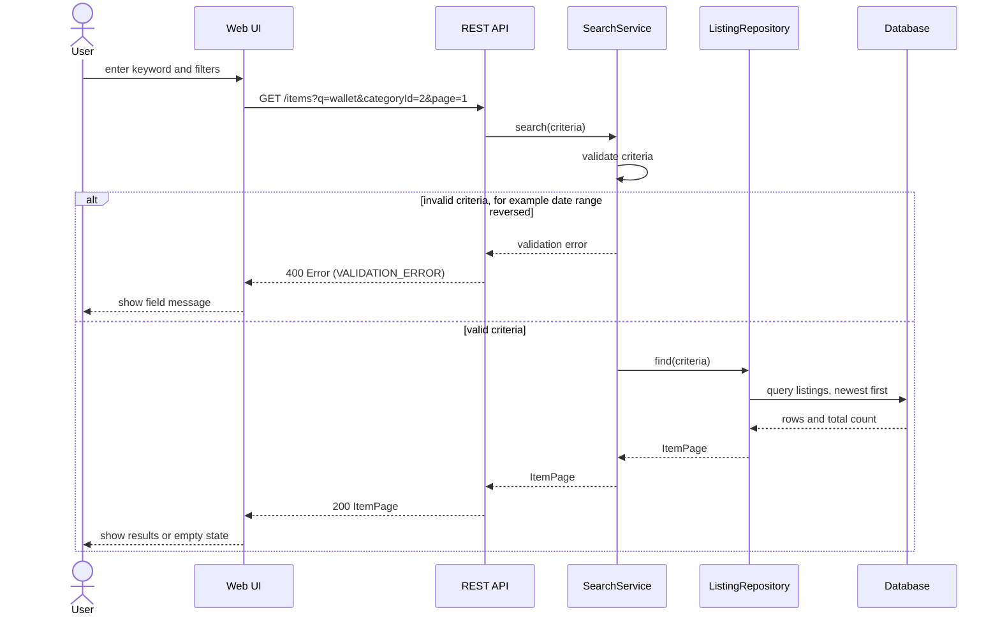
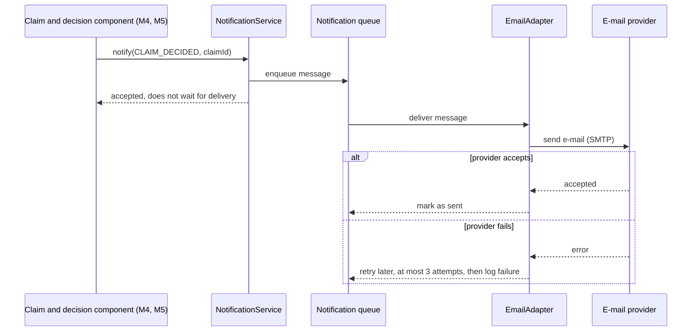
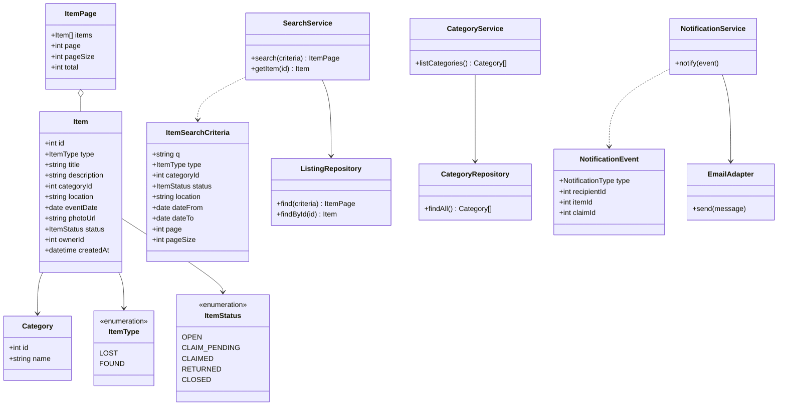
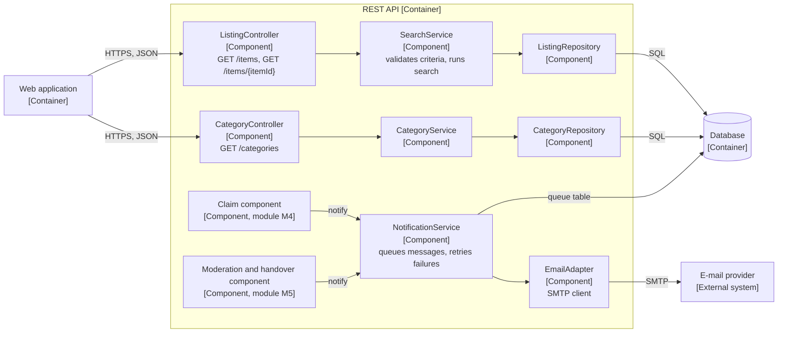

# Architecture – Module M3: Discovery and Notification

**Project:** Campus Lost and Found Portal | **Team:** Team 24
**Module owner:** Aslıhan Kaçmaz (K3) | **Sprint:** 2 | **Status:** Draft for review
**Related:** `docs/architecture/c4-context-container.md` (C4 L1 and L2), `docs/architecture/adr.md`, `api/openapi.yaml`

All diagrams are Mermaid so that they render on GitHub and keep a readable history. Names of classes and fields follow the OpenAPI draft.

## 1. Sequence diagram: search and filter listings

## 2. Sequence diagram: e-mail notification after a claim decision

## 3. Class diagram: discovery and notification

Note: `RETURNED` is recorded by staff in module M5 (handover). It must be added to `ItemStatus` in the OpenAPI draft (v0.2.0, see `docs/architecture/openapi-v0.2-changes.md`). The state diagram of listings (module M2) must use the same five values.

## 4. C4 Level 3: components of the REST API for search and notification

| Component | Responsibility | Requirement |
|---|---|---|
| ListingController | Receives list, search and detail requests, maps query parameters to criteria, returns `ItemPage`, `Item` or `Error` | FR-M3-01 to FR-M3-05 |
| CategoryController | Returns the category list | FR-M3-06 |
| SearchService | Validates criteria (for example date range), applies pagination limits, never returns personal data | FR-M3-01 to FR-M3-05, NFR-M3-02 |
| ListingRepository, CategoryRepository | Database access | NFR-M3-01 |
| NotificationService | Receives events from M4 and M5, creates messages for the registered address, queues them, retries failures | FR-M3-07, FR-M3-08 |
| EmailAdapter | Sends one message through the e-mail provider | FR-M3-07 |
