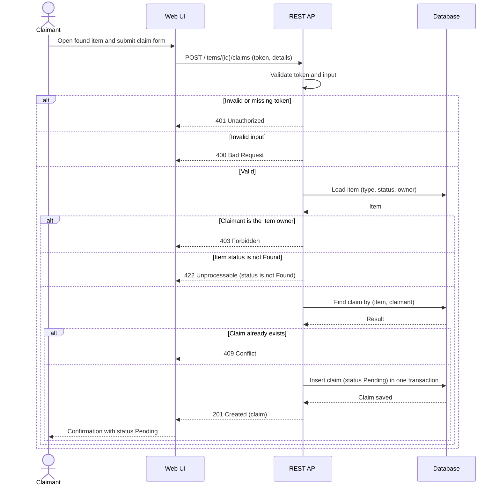
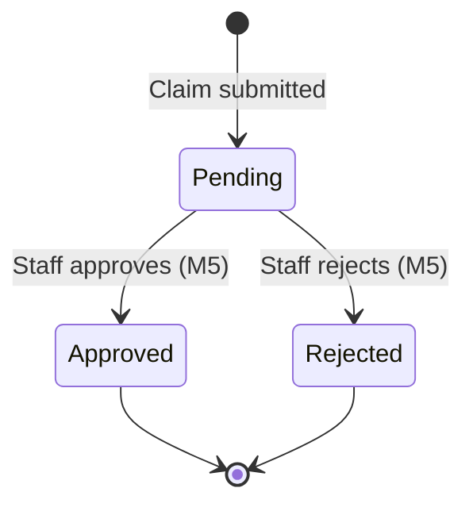
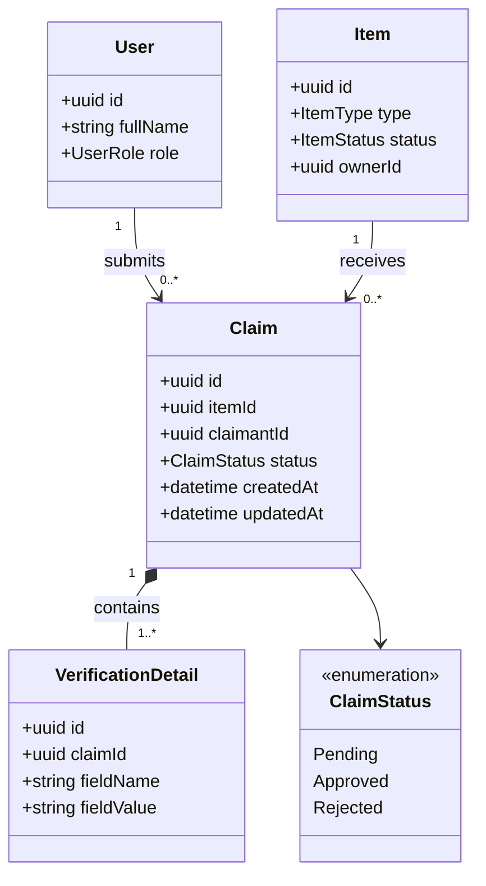
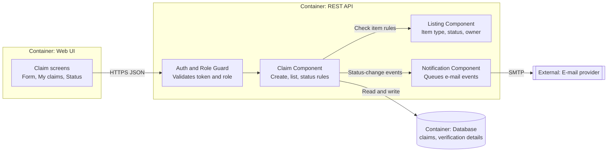
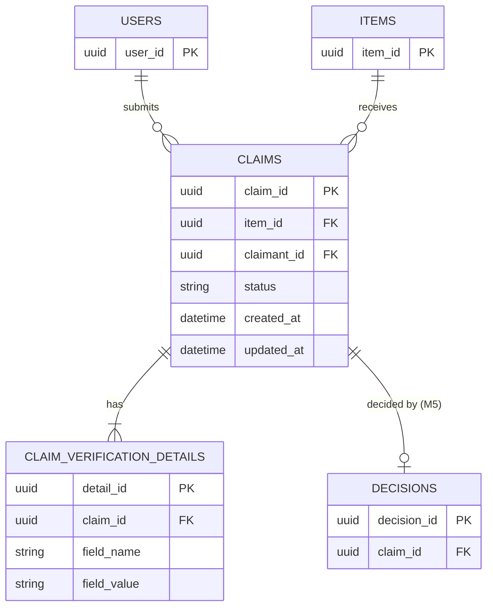

# M4 – Architecture: Ownership Claim and Verification

**Project:** Campus Lost and Found Portal
**Module owner:** Ceren Torun (@ccerentrn)

> Status names (Pending, Approved, Rejected) must match `ClaimStatus` in `api/openapi.yaml`.

## 1. Sequence Diagram – Create a claim

## 2. State Diagram – Claim status

## 3. Class Diagram

## 4. C4 Level 3 – Component Diagram (Claim component)
Drawn as a Mermaid flowchart that follows C4 component notation (name, responsibility).

## 5. Database Schema (ER Diagram) – M4 tables
`USERS`, `ITEMS`, and `DECISIONS` belong to other modules and are shown as references only. Aslıhan merges all modules into `docs/architecture/database-schema.md`.

**Constraints:** unique pair (`item_id`, `claimant_id`) on `CLAIMS` enforces NFR-M4-02. `field_name` is one of description, color, brand, contents *(proposed)*.
**License note:** All libraries chosen for this module must be MIT-compatible.
