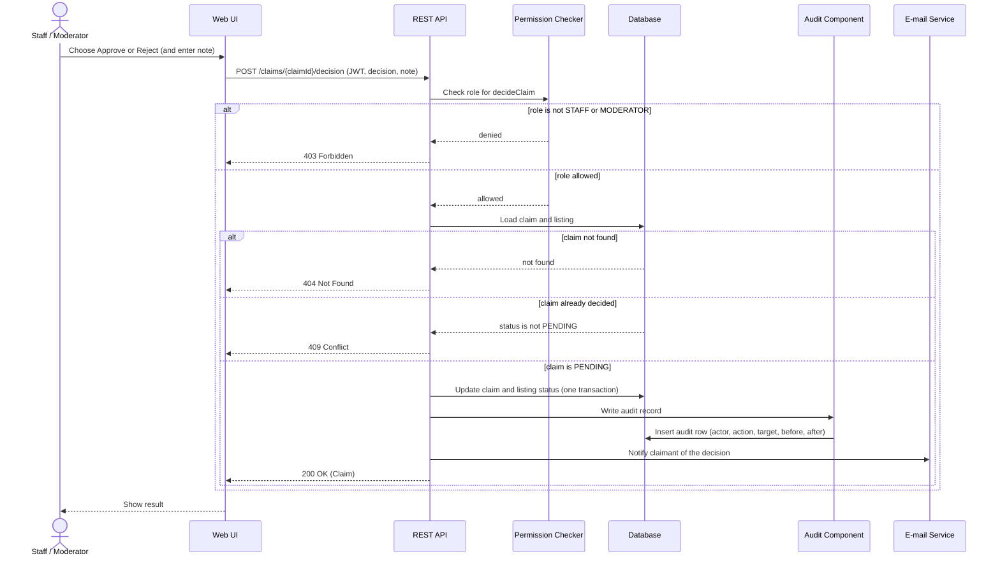
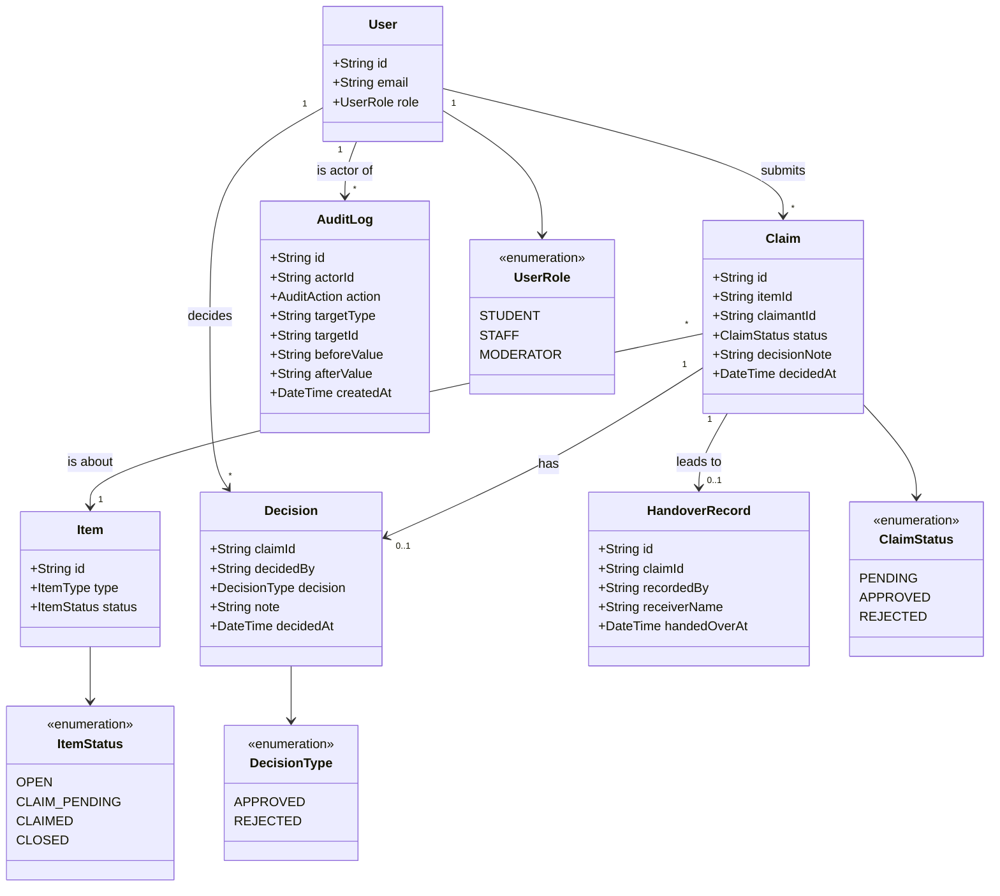
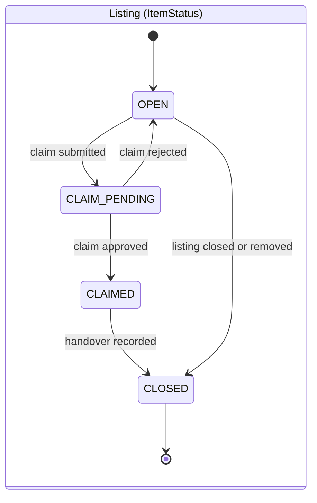
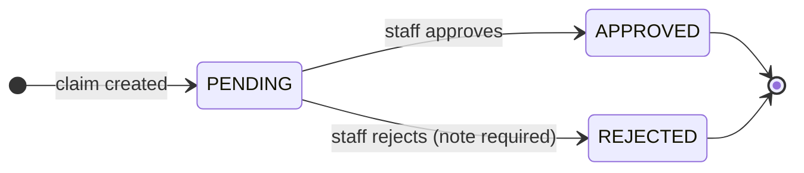
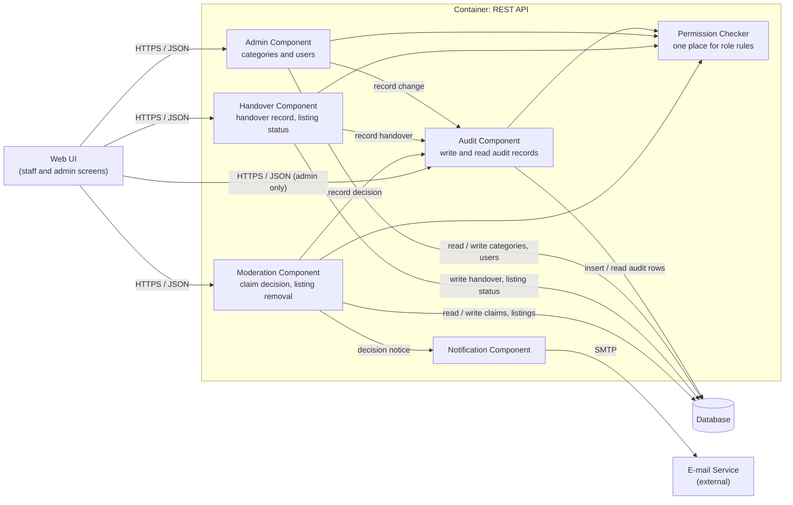

# Module 5 (M5) — Architecture & UML Specifications

**Module Owner:** Berra Bayındır (DevOps Engineer)  
**Scope:** Claim decision, handover, moderation and audit. All diagrams are written in Mermaid so that they are versioned with the repository.

---

## 1. Sequence Diagram: Claim Decision (with role and conflict checks)

---

## 2. Class Diagram: Decision, Handover and Audit Domain Model

---

## 3. State Diagram: Listing and Claim Status

The listing states are the `ItemStatus` values and the claim states are the `ClaimStatus` values of `api/openapi.yaml`.

---

## 4. C4 Level 3 Component Diagram: Moderation and Audit Components

Container: **REST API**. The components below belong to module M5.

### Component responsibilities

| Component | Responsibility | Related FR |
|---|---|---|
| Moderation Component | Decide claims, remove listings | FR-M5-01, FR-M5-04 |
| Handover Component | Save handover and set listing status | FR-M5-02, FR-M5-03 |
| Admin Component | Manage categories and users | FR-M5-05, FR-M5-06 |
| Audit Component | Write and read append-only audit records | FR-M5-07 |
| Permission Checker | Single place for role rules | NFR-M5-01, NFR-M5-03 |
| Notification Component | Send e-mail about decisions | FR-M5-01 |
