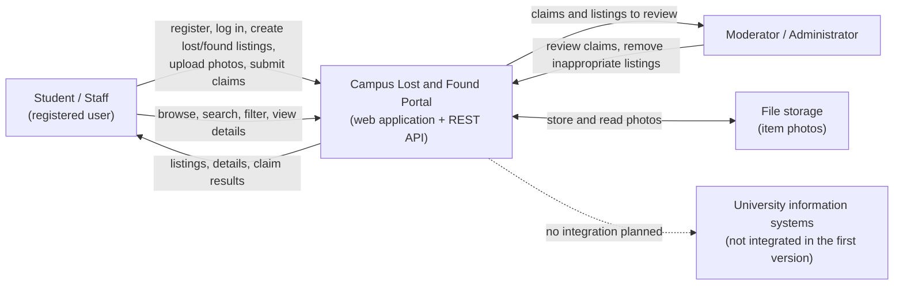

# System Context Diagram and External Interactions

**Project:** Campus Lost and Found Portal | **Team:** Team 24
**Sprint 1 Deliverable | - Software Architect (Aslıhan Kaçmaz)**

This document supports the System Vision and Boundary deliverable. It is aligned with the Project Proposal (`project_proposal.md`, sections 3 and 6), the Initial Product Backlog (`initial_product_backlog.md`) and the OpenAPI draft (`api/openapi.yaml`).

## 1. System Context Diagram

Solid arrows are interactions planned for the system. The dashed arrow marks an integration that is explicitly outside the first version (Proposal 5.1 and 6.2).

## 2. System Responsibilities

- Register users and authenticate them (US-01, US-02)
- Let logged-in users create lost and found listings with name, description, category, location and date (US-03, US-04)
- Display all listings and let users search by keyword and filter by category and status (US-05, US-06, US-07)
- Show listing details and photos (US-08, US-09)
- Let users view their profile, their own listings and their own claims (US-10, Proposal 6.1)
- Let users submit ownership claims, and let the listing owner or a moderator accept or reject them (Proposal 6.1)
- Let moderators remove inappropriate or misleading listings (Proposal 3)
- Enforce role-based access (student, staff, moderator) and keep contact details out of public listings

## 3. External Interactions

| Actor / external system | Direction | Purpose | Source | Status |
|---|---|---|---|---|
| Student / Staff | Two-way | Register, log in, publish, browse, search, upload photos, submit claims | Backlog US-01 to US-10, Proposal 6.1 | In scope |
| Moderator / Administrator | Two-way | Review claims, remove inappropriate listings | Proposal 2, 3 and 6.1 | In scope |
| File storage | Two-way | Store and serve item photos | US-09 | In scope; accepted formats and size limit to be agreed |
| University information systems | None | Student information system integration | Proposal 5.1 and 6.2 | Out of scope |

## 4. System Boundary

**Inside the boundary:** the web user interface, the REST API described in `api/openapi.yaml`, and the stored user, listing, category, claim and photo data.

**Outside the boundary:**
- Physical handover of items between people (Backlog section 10: outside the platform's direct control)
- Integration with university student information systems (Proposal 6.2)
- Payment processing, automatic ownership verification using AI, police or governmental databases, native mobile applications, real-time location tracking (Proposal 6.2)
- E-mail notifications (not mentioned in the proposal or the backlog)

## 5. Traceability: Requirements to API Operations

| Requirement | API operation |
|---|---|
| US-01 Register | `POST /auth/register` |
| US-02 Log in | `POST /auth/login` |
| US-03 Create lost listing | `POST /items` with `type: LOST` |
| US-04 Create found listing | `POST /items` with `type: FOUND` |
| US-05 View all listings | `GET /items` |
| US-06 Search by keyword | `GET /items?q=` |
| US-07 Filter by category | `GET /items?categoryId=` and `GET /categories` |
| US-08 View item details | `GET /items/{itemId}` |
| US-09 Upload item photo | `POST /items/{itemId}/photo` |
| US-10 View my listings | `GET /users/me/items` |
| Proposal: user profile viewing | `GET /users/me` |
| Proposal: filter by status | `GET /items?status=` |
| Proposal: submit ownership claim | `POST /items/{itemId}/claims` |
| Proposal: review claim requests | `GET /items/{itemId}/claims`, `POST /claims/{claimId}/decision` |
| Proposal: basic claim management | `GET /users/me/claims` |
| Proposal: basic listing management, moderator removal | `PUT /items/{itemId}`, `DELETE /items/{itemId}` |

## 6. Assumptions and Open Decisions

- The Project Proposal lists claim submission, claim review, user profile and basic administration as in-scope features, but the Initial Product Backlog does not yet contain user stories for them. This API follows the proposal for these items. The Product Owner should add matching user stories, or the team should move these items to a later release and the claim operations will be removed.
- Users log in with ordinary account credentials (e-mail and password); this may change if the team chooses university accounts.
- Item photos are limited to JPEG and PNG; the final formats and maximum size are to be agreed.
- The category list is to be defined by the team; `GET /categories` returns whatever list is agreed.
- Contact details are not part of any listing; claims carry only a message and a proof text.
