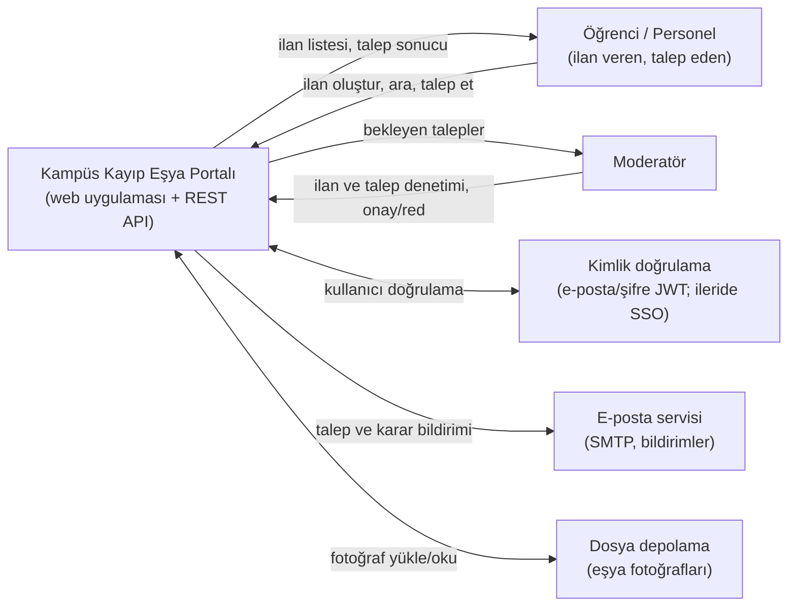

# Sistem Bağlam Diyagramı ve Dış Sistem Etkileşimleri

**Proje:** Kampüs Kayıp Eşya Portalı (Lost and Found Management System)
**Hazırlayan rol:** Lead Software Architect (K3)

## 1. Sistem Bağlam Diyagramı

## 2. Sistem Sorumlulukları

- Kayıp ve bulunan eşya ilanlarını yayınlama, arama ve filtreleme
- Sahiplik talebi alma ve onay/red akışını yürütme
- İlan ve talep durumlarını takip etme (`OPEN`, `CLAIM_PENDING`, `RETURNED`, `CLOSED`)
- Rol bazlı yetkilendirme (öğrenci, personel, moderatör)
- Talep ve karar bildirimlerini e-posta ile iletme

## 3. Dış Sistem Etkileşimleri

| Dış sistem | Yön | Amaç | Sprint 1 durumu |
|---|---|---|---|
| Öğrenci / Personel | İki yönlü | İlan verme, arama, sahiplik talebi | Kapsam içi |
| Moderatör | İki yönlü | İlan ve talep denetimi, onay/red | Kapsam içi |
| Kimlik doğrulama | İki yönlü | Giriş ve token doğrulama | Kapsam içi (JWT); üniversite SSO sonraya bırakıldı |
| E-posta servisi | Sistemden dışarı | Yeni talep ve karar bildirimi | Kapsam içi |
| Dosya depolama | İki yönlü | Eşya fotoğrafları | Kapsam içi, ilk sürümde isteğe bağlı |
| WhatsApp grupları, duvar panoları | Yok | Mevcut dağınık yöntem | Entegrasyon kapsam dışı |

## 4. Sistem Sınırı

- **Sınır içi:** web arayüzü, REST API (`openapi.yaml`), ilan/talep/kullanıcı verisi.
- **Sınır dışı:** üniversite öğrenci bilgi sistemi, WhatsApp ve sosyal medya entegrasyonları, fiziksel eşya teslim süreci.
