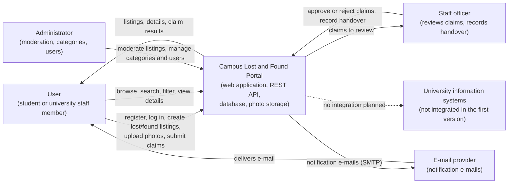

# System Context Diagram and External Interactions

**Project:** Campus Lost and Found Portal | **Team:** Team 24
**Owner:** Aslıhan Kaçmaz (K3, Architect) | **Version:** Sprint 2 update

This document supports the System Vision and Boundary deliverable. It is aligned with the Project Proposal (`project_proposal.md`), the Initial Product Backlog (`initial_product_backlog.md`), the OpenAPI draft (`api/openapi.yaml`) and the C4 model (`docs/architecture/c4-context-container.md`).

**Changes in Sprint 2:** the e-mail provider is now an external system (notifications, module M3); file storage is no longer drawn as an external system but is a container inside the system boundary; person roles follow the Sprint 2 module plan (User, Staff officer, Administrator).

## 1. System Context Diagram

Solid arrows are interactions planned for the system. The dashed arrow marks an integration that is explicitly outside the first version (Proposal 5.1 and 6.2). Photo storage is part of the system (see C4 Level 2).

## 2. System Responsibilities

- Register users and authenticate them (US-01, US-02)
- Let logged-in users create lost and found listings with name, description, category, location and date (US-03, US-04)
- Display all listings and let users search by keyword and filter by category, date, location and status (US-05, US-06, US-07, US-40)
- Show listing details and photos (US-08, US-09)
- Let users view their profile, their own listings and their own claims (US-10, Proposal 6.1)
- Let users submit ownership claims, and let staff officers (or the listing owner) accept or reject them (Proposal 6.1)
- Record handover of an item and keep an audit log of decisions (Sprint 2 plan, module M5)
- Let administrators remove inappropriate or misleading listings and manage categories and users (Proposal 3, Sprint 2 plan, module M5)
- Notify users by e-mail about claim results and listing status changes (Sprint 2 plan, module M3)
- Enforce role-based access and keep contact details out of listings

## 3. External Interactions

| Actor / external system | Direction | Purpose | Source | Status |
|---|---|---|---|---|
| User | Two-way | Register, log in, publish, browse, search, upload photos, submit claims | Backlog US-01 to US-10, Proposal 6.1 | In scope |
| Staff officer | Two-way | Review claims, record handover | Sprint 2 plan, module M5 | In scope |
| Administrator | Two-way | Moderate listings, manage categories and users | Proposal 3, Sprint 2 plan, module M5 | In scope |
| E-mail provider | System to provider, provider to user | Deliver notification e-mails | Sprint 2 plan, module M3 (FR-M3-07) | In scope |
| University information systems | None | Student information system integration | Proposal 5.1 and 6.2 | Out of scope |

## 4. System Boundary

**Inside the boundary:** the web user interface, the REST API described in `api/openapi.yaml`, the database (users, listings, categories, claims, audit log), the photo storage and the notification queue.

**Outside the boundary:**
- E-mail delivery infrastructure (external provider)
- Physical handover of items between people (Backlog section 10: outside the platform's direct control); the system only records that it happened
- Integration with university student information systems (Proposal 6.2)
- Payment processing, automatic ownership verification using AI, police or governmental databases, native mobile applications, real-time location tracking (Proposal 6.2)

## 5. Traceability: Requirements to API Operations

| Requirement | API operation |
|---|---|
| US-01 Register | `POST /auth/register` |
| US-02 Log in | `POST /auth/login` |
| US-03 Create lost listing | `POST /items` with `type: LOST` |
| US-04 Create found listing | `POST /items` with `type: FOUND` |
| US-05 View all listings | `GET /items` |
| US-06 Search by keyword | `GET /items?q=` |
| US-07 Filter by category | `GET /items?categoryId=` and `GET /categories` |
| US-08 View item details | `GET /items/{itemId}` |
| US-09 Upload item photo | `POST /items/{itemId}/photo` |
| US-10 View my listings | `GET /users/me/items` |
| US-40 Filter by date, location, status | `GET /items?dateFrom=&dateTo=&location=&status=` (OpenAPI v0.2.0) |
| Proposal: user profile viewing | `GET /users/me` |
| Proposal: submit ownership claim | `POST /items/{itemId}/claims` |
| Proposal: review claim requests | `GET /items/{itemId}/claims`, `POST /claims/{claimId}/decision` |
| Proposal: basic claim management | `GET /users/me/claims` |
| Proposal: basic listing management, moderator removal | `PUT /items/{itemId}`, `DELETE /items/{itemId}` |
| E-mail notifications (US-41, US-42) | no endpoint; triggered by `POST /items/{itemId}/claims`, `POST /claims/{claimId}/decision` and `PUT /items/{itemId}` |

Operations for handover records, audit log, category management and user management are added to the OpenAPI draft after the module owners of M5 define their requirements.

## 6. Assumptions and Open Decisions

- Users log in with ordinary account credentials (e-mail and password); this may change if the team chooses university accounts (ADR-002).
- Item photos are limited to JPEG and PNG, at most 5 MB; the final limits are to be agreed (ADR-003).
- The category list is defined by the team and managed by administrators; `GET /categories` returns the agreed list.
- Contact details are not part of any listing; claims carry only a message and a proof text.
- Role names in the OpenAPI draft (STUDENT, STAFF, MODERATOR) are to be aligned with User, Staff officer and Administrator.
