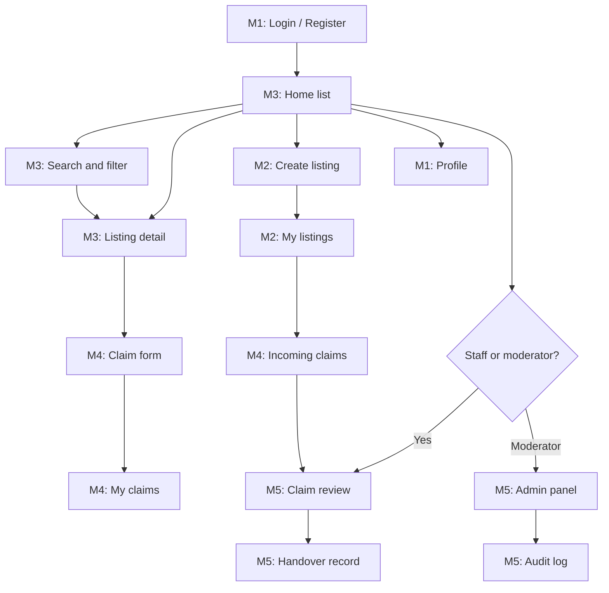

# Figma Links and Screens

**Owner:** Berra Bayındır (DevOps Engineer)  
**Project:** Campus Lost and Found Portal (Team 24)

---

## 1. Figma File

| Item | Link |
|---|---|
| **Main Figma file (all modules)** |https://www.figma.com/design/ahb5vkWYGgXs1UmzzxNOvX/Campus-Lost-and-Found-Portal---Team-24?node-id=1-7&t=K30w3LhxnVy7iGIF-1|

Access: the link is set to **"Anyone with the link can view"**. It was tested in a private (incognito) browser window. All team members have **edit** access.

## 2. Pages in the Figma File

| Page | Owner | Screens |
|---|---|---|
| M1 – Identity and Profile | İrem Köse | Register, Login, Profile (+ error states) |
| M2 – Listing Management | Tuğba Kezban Çay | Create listing, Edit listing, My listings, Photo upload |
| M3 – Discovery and Notification | Aslıhan Kaçmaz | Home list, Search and filter, Listing detail, E-mail template |
| M4 – Claim | Ceren Torun | Claim form, My claims, Claim status, Incoming claims |
| M5 – Approval, Moderation, Audit | Berra Bayındır | Claim review, Handover record, Admin panel, Audit log |
| Components | All | Shared buttons, forms, colors, fonts |

## 3. Shared Style Guide

| Element | Rule |
|---|---|
| Colors | Defined once on the Components page and reused by all pages |
| Fonts | One font family for all screens |
| Buttons and forms | Components from the Components page (no copies) |

## 4. Overall Navigation Flow

## 5. Screenshots

Screenshots are stored in this repository under `docs/ux/screens/`.

| Module | Screen | File |
|---|---|---|
| M5 | Claim review | `docs/ux/screens/m5/m5-01-claim-review.png` |
| M5 | Handover record | `docs/ux/screens/m5/m5-02-handover-record.png` |
| M5 | Admin panel | `docs/ux/screens/m5/m5-03-admin-panel.png` |
| M5 | Audit log | `docs/ux/screens/m5/m5-04-audit-log.png` |

The other modules add their screenshots in their own folders (`docs/ux/screens/m1/` ... `m4/`).

## 6. Link Check (before submission)

- [ ] Main file link opens in a private window without signing in
- [ ] Prototype link opens in a private window and can be clicked through
- [ ] All five module pages and the Components page exist
- [ ] Every screen of each module flow (`docs/ux/flows/mX.md`) exists as a frame
