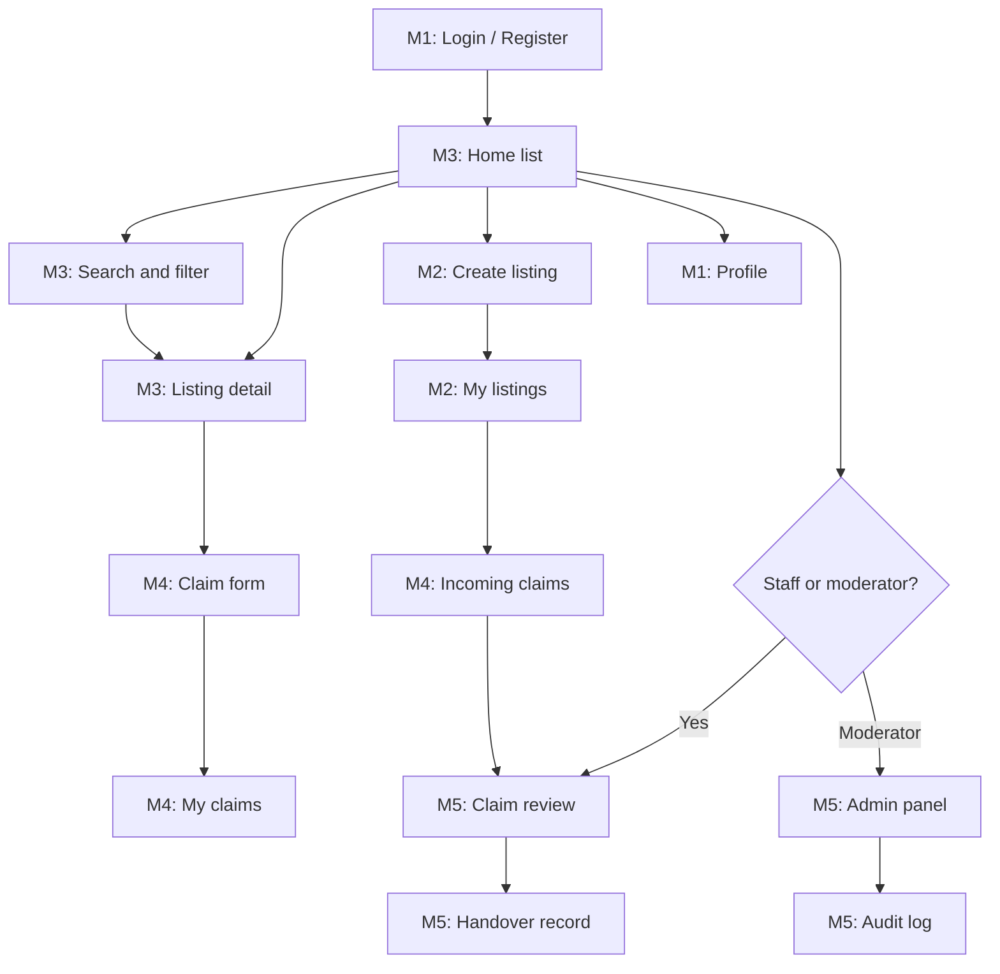

# Figma Links and Screens

Draft. Owner: Berra

## Module M3 – Discovery and Notification (Aslıhan Kaçmaz)

- Figma file: [Campus Lost and Found Portal – Team 24](https://www.figma.com/design/ahb5vkWYGgXs1UmzzxNOvX/Campus-Lost-and-Found-Portal---Team-24?node-id=1-4&t=l6dschdzdt82Td1F-1) (view access for everyone)
- User flows and screen list: `docs/ux/flows/m3.md`
- Screenshots: `docs/ux/screens/m3/`

| Screen | Name | Stories |
|---|---|---|
| S-M3-01 | Main list | US-05 |
| S-M3-02 | Search and filter | US-06, US-07, US-40 |
| S-M3-03 | Listing detail | US-08 |
| S-M3-04 | E-mail notification | US-41, US-42 |

**Owner:** Berra Bayındır (DevOps Engineer)  
**Project:** Campus Lost and Found Portal (Team 24)

---

## 1. Figma File & Interactive Prototypes

| Item | Link |
|---|---|
| **Main Figma File (All Modules)** | [https://www.figma.com/design/ahb5vkWYGgXs1UmzzxNOvX/Campus-Lost-and-Found-Portal---Team-24?node-id=1-7&t=K30w3LhxnVy7iGIF-1](https://www.figma.com/design/ahb5vkWYGgXs1UmzzxNOvX/Campus-Lost-and-Found-Portal---Team-24?node-id=1-7&t=K30w3LhxnVy7iGIF-1) |
| **Interactive Prototype — M1 (Auth & Profile)** | [https://www.figma.com/proto/ahb5vkWYGgXs1UmzzxNOvX/Campus-Lost-and-Found-Portal---Team-24?node-id=1-2&t=K30w3LhxnVy7iGIF-1](https://www.figma.com/proto/ahb5vkWYGgXs1UmzzxNOvX/Campus-Lost-and-Found-Portal---Team-24?node-id=1-2&t=K30w3LhxnVy7iGIF-1) |
| **Interactive Prototype — M2 (Listings)** | [https://www.figma.com/proto/ahb5vkWYGgXs1UmzzxNOvX/Campus-Lost-and-Found-Portal---Team-24?node-id=1-3&t=K30w3LhxnVy7iGIF-1](https://www.figma.com/proto/ahb5vkWYGgXs1UmzzxNOvX/Campus-Lost-and-Found-Portal---Team-24?node-id=1-3&t=K30w3LhxnVy7iGIF-1) |
| **Interactive Prototype — M3 (Search & Discovery)** | [https://www.figma.com/proto/ahb5vkWYGgXs1UmzzxNOvX/Campus-Lost-and-Found-Portal---Team-24?node-id=1-4&t=K30w3LhxnVy7iGIF-1](https://www.figma.com/proto/ahb5vkWYGgXs1UmzzxNOvX/Campus-Lost-and-Found-Portal---Team-24?node-id=1-4&t=K30w3LhxnVy7iGIF-1) |
| **Interactive Prototype — M4 (Claims)** | [https://www.figma.com/proto/ahb5vkWYGgXs1UmzzxNOvX/Campus-Lost-and-Found-Portal---Team-24?node-id=1-5&t=K30w3LhxnVy7iGIF-1](https://www.figma.com/proto/ahb5vkWYGgXs1UmzzxNOvX/Campus-Lost-and-Found-Portal---Team-24?node-id=1-5&t=K30w3LhxnVy7iGIF-1) |
| **Interactive Prototype — M5 (Approval & Admin)** | [https://www.figma.com/proto/ahb5vkWYGgXs1UmzzxNOvX/Campus-Lost-and-Found-Portal---Team-24?node-id=1-6&t=K30w3LhxnVy7iGIF-1](https://www.figma.com/proto/ahb5vkWYGgXs1UmzzxNOvX/Campus-Lost-and-Found-Portal---Team-24?node-id=1-6&t=K30w3LhxnVy7iGIF-1) |

**Access:** Set to **"Anyone with the link can view"** and verified in a private (incognito) browser window without signing in. All team members have **edit** access.

---

## 2. Pages in the Figma File

| Figma Page | Module & Owner | Covered Screens & Traceability |
|---|---|---|
| `01 Auth & Profile` | **M1** — İrem Köse | Register, Login, Profile, KVKK consent & error states (`FR-M1-01..07`, `US-01..02`) |
| `02 Listings` | **M2** — Tuğba Kezban Çay | Create listing, Edit listing, My listings, Photo upload (`FR-M2-01..07`, `US-03..04, US-09..10, US-30..32`) |
| `03 Search` | **M3** — Aslıhan Kaçmaz | Home list, Search and filter, Listing detail, E-mail template (`FR-M3-01..07`, `US-05..08, US-40`) |
| `04 Claims` | **M4** — Ceren Torun | Claim form, My claims, Claim status, Incoming claims (`FR-M4-01..06`, `US-11..13`) |
| `05 Approval and Admin` | **M5** — Berra Bayındır | Pending claims, Claim decision, Handover record, Admin panel & Audit log (`FR-M5-01..07`, `US-20..27`) |
| `99 Overall Flow` / `Components` | **All Team** | End-to-end connected user journeys and shared UI components |

---

## 3. Shared Style Guide

| Element | Rule |
|---|---|
| Colors | Defined once in the shared style guide and reused across all pages |
| Fonts | Consistent typography (`Inter`) across all screens |
| Buttons and forms | Reusable shared components (no detached duplicates) |

---

## 4. Overall Navigation Flow

---

## 5. Screenshots

Module 5 UI screen captures stored in the repository:

| Module | Screen | Traceability | File Path in Repository |
|---|---|---|---|
| M5 | Pending Claims | `FR-M5-01` (`US-20`) | `docs/ux/docs/ux/screens/m5/Staff - Pending Claims.png` |
| M5 | Claim Decision | `FR-M5-01` (`US-21`) | `docs/ux/docs/ux/screens/m5/Staff - Claim Decision.png` |
| M5 | Handover Record | `FR-M5-02`, `FR-M5-03` (`US-22`, `US-23`) | `docs/ux/docs/ux/screens/m5/Staff - Handover Record.png` |
| M5 | Admin Panel & Audit Log | `FR-M5-04..07` (`US-24..27`) | `docs/ux/docs/ux/screens/m5/Admin-Panel and Audit Log.png` |

*(Other modules store their exported frames under `docs/ux/screens/m1/` – `m4/`.)*

---

## 6. Link Check (Before Submission)

- [x] Main file link opens in a private window without signing in
- [x] Prototype links open in a private window and can be clicked through
- [x] All five module pages and shared components exist
- [x] Frame headers include `FR | US | Endpoint` traceability annotations
