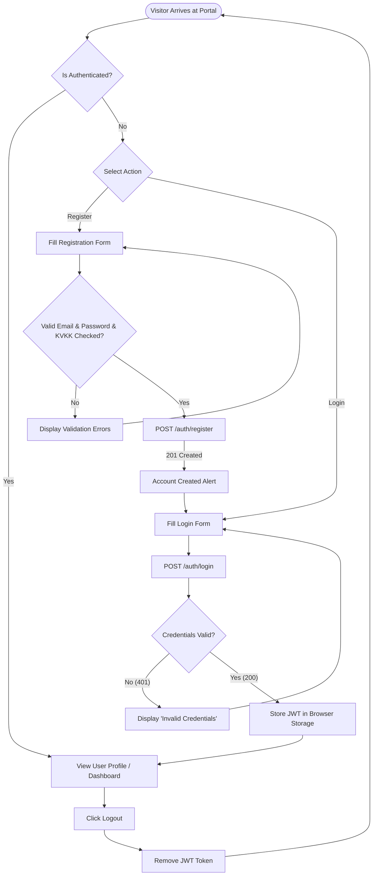

# Module 1 (M1) — User Flow & Interface Specifications

**Module Owner:** İrem Köse (K1 — Product Owner)  
**Target Screens:** Registration Screen, Login Screen, User Profile Screen, Error & Validation Dialogs.

---

## 1. User Flow Diagram (Mermaid)

---

## 2. Screen Specifications

### Screen `SCR-M1-01`: Registration Screen
* **Components:**
  * Full Name (Text input, mandatory)
  * University Email (Text input, mandatory, pattern: `*@*.edu.tr`)
  * Password (Password input, masked, min 8 chars)
  * Password Confirmation (Password input, masked)
  * KVKK Terms & Privacy Checkbox (Mandatory toggle)
  * "Register" Button (Primary action)
  * Link: "Already have an account? Log in"
* **Validation States:**
  * Inline red warning if email domain is invalid.
  * Real-time password strength indicator (Weak / Medium / Strong).

### Screen `SCR-M1-02`: Login Screen
* **Components:**
  * University Email (Text input)
  * Password (Password input)
  * "Log In" Button (Primary action)
  * Link: "Don't have an account? Register"
* **Error Banner:**
  * Displays "Invalid email address or password" on HTTP 401 response.

### Screen `SCR-M1-03`: User Profile Screen
* **Components:**
  * Header showing Full Name and Account Badge (`Student` / `Staff` / `Admin`)
  * Email Address & Registration Date fields
  * Quick Links: "My Reported Items", "My Ownership Claims"
  * "Log Out" Button (Secondary action)
