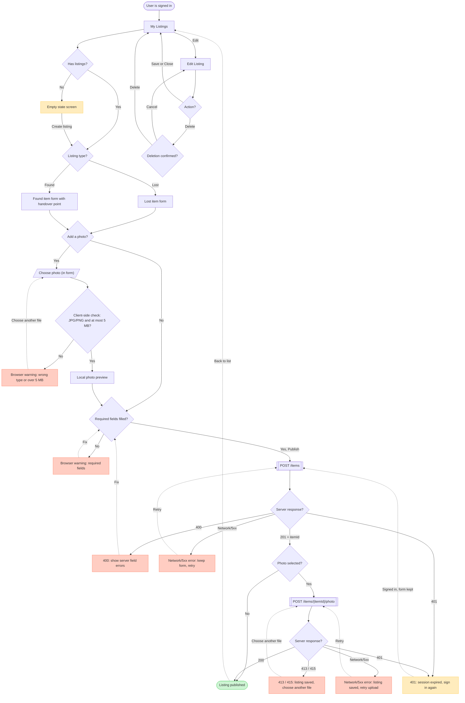

# User Flow M2 - Listing Management

**Module owner:** Tugba Kezban Cay (tugbacay21)  
**Related issue:** #49  
**Related requirements:** FR-M2-01 … FR-M2-07, NFR-M2-03 (`docs/srs/m2-listings.md`, `docs/nfr/m2.md`)  
**Figma design:** team file, page `02 Listings` - https://www.figma.com/design/ahb5vkWYGgXs1UmzzxNOvX  
**FigJam diagram:** https://www.figma.com/board/26Rv54kRU2JEZrfHzS40lt/M2-Listing-Management---User-Flow--v2- (same flow as the Mermaid copy below)

The flow starts on the **My Listings** screen and covers creating a lost or found listing, uploading a photo, editing, closing and deleting a listing, including error and alternative paths.

**Photo handling:** The user chooses the photo and sees a local preview while filling in the form; the browser already checks type and size and shows a warning (Figma error screens show the same texts). Browser warnings are **not** HTTP responses; the server still validates and may return `400`, `413` or `415`, which are shown separately. The photo is sent to the API only **after** `POST /items` returns `201` with the new `itemId` (see sequence diagram in `docs/architecture/m2-uml.md`). If the server rejects the photo (`413`/`415`) the listing stays saved and the user can choose another file; on a network or server error the user can retry the same upload (UC-M2-02, A2-A4). If the session has expired (`401`), the user signs in again and the request is repeated (UC-M2-01 A2, UC-M2-02 A5).

## Screen Mapping

| Flow step | Figma screen (page `02 Listings`) |
| --- | --- |
| My Listings | My Listings |
| Empty state screen | My Listings – Empty State |
| Lost item form | Create Listing – Lost |
| Found item form with handover point | Create Listing – Found |
| Browser warning: required fields / wrong type | Create Listing – Error (required field + 415) |
| Browser warning: over 5 MB | Create Listing – Photo Too Large (413) |
| Listing published | My Listings – Listing Published |
| Edit Listing | Edit Listing |
| Deletion confirmed? | Edit Listing – Delete Confirmation |
