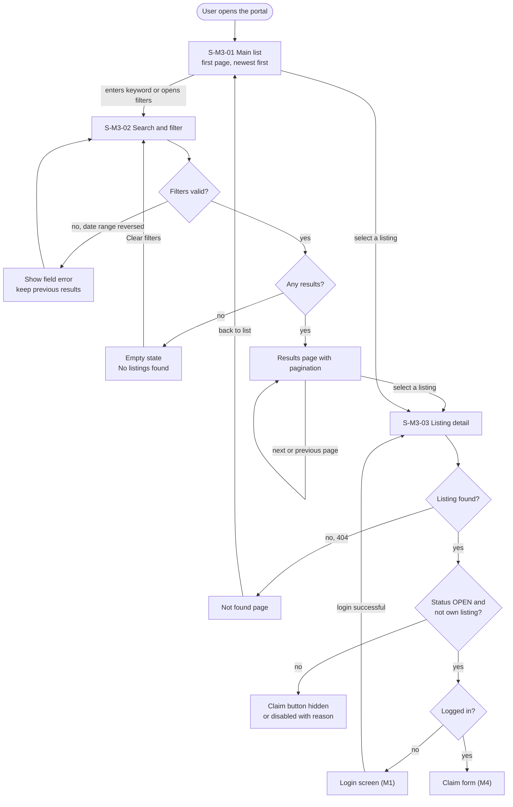
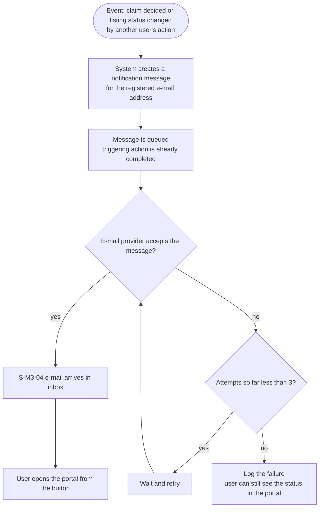

# UX – Module M3: Discovery and Notification

**Project:** Campus Lost and Found Portal | **Team:** Team 24
**Module owner:** Aslıhan Kaçmaz (K3) | **Sprint:** 2 | **Status:** Draft for review

**Figma prototype:** [Campus Lost and Found Portal – Team 24 (M3 screens)](https://www.figma.com/design/ahb5vkWYGgXs1UmzzxNOvX/Campus-Lost-and-Found-Portal---Team-24?node-id=1-4&t=l6dschdzdt82Td1F-1) (view access for everyone). Screenshots of the four screens are in `docs/ux/screens/m3/`.

## 1. Screens

| ID | Screen | Purpose | Stories |
|---|---|---|---|
| S-M3-01 | Main list | Show the newest listings with pagination | US-05 |
| S-M3-02 | Search and filter | Keyword search, category, date range, location, type and status filters | US-06, US-07, US-40 |
| S-M3-03 | Listing detail | Show all listing fields and photo, entry point to the claim form | US-08 |
| S-M3-04 | Notification e-mail template | E-mail for claim result and status change | US-41, US-42 |

### S-M3-01 Main list
- **Elements:** header with portal name and login or profile link; search box; "Filters" button; list of cards (photo thumbnail, title, LOST or FOUND label, category, location, date, status label); pagination bar with total count.
- **States:** loading (skeleton cards), default, empty ("No listings found"), error ("Something went wrong, try again").
- **Does not show:** name, e-mail or phone of any user.

### S-M3-02 Search and filter
- **Elements:** keyword box; category drop-down (from the category list); date from and date to pickers; location text box; type switch (All, Lost, Found); status drop-down; "Apply" and "Clear filters" buttons; active-filter chips above the results.
- **States:** default, validation error (date range reversed, field message, previous results kept), no results, loading.

### S-M3-03 Listing detail
- **Elements:** large photo or placeholder; title; type and status label; description; category; location; event date; created date; "Claim this item" button.
- **States:** default; not logged in (button leads to login and returns here); status not OPEN (button disabled with reason); own listing (button hidden); not found (404 page with link to the list).

### S-M3-04 Notification e-mail template
- **Elements:** subject "Update on your lost-and-found listing" or "Result of your claim"; listing title; new status or claim result; decision note if given; button "Open in portal".
- **Does not show:** any personal data of another user.

## 2. User flow: find a listing and continue to claim

## 3. User flow: e-mail notification

## 4. Navigation to other modules

| From | To | Condition |
|---|---|---|
| S-M3-03 | Login screen (M1) | User is not logged in and presses "Claim this item" |
| S-M3-03 | Claim form (M4) | User is logged in, listing is OPEN and not the user's own |
| S-M3-04 | S-M3-03 | User presses "Open in portal" |
