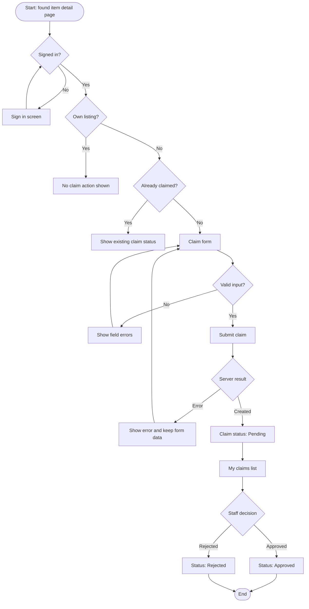
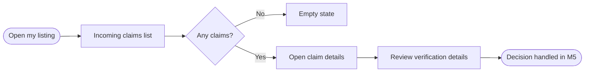

# M4 – User Flow: Ownership Claim and Verification

**Project:** Campus Lost and Found Portal
**Module owner:** Ceren Torun (@ccerentrn)

- **Figma page:** `Ceren 04 Claims`
- **Figma share link (view access for everyone):** <https://www.figma.com/design/ahb5vkWYGgXs1UmzzxNOvX/Campus-Lost-and-Found-Portal---Team-24?node-id=1-5&t=R671xwCLFMla1QKH-1>
- **All-module links:** `docs/ux/figma-links.md`
- **Screen size:** Desktop 1440×1024
- **Screenshots:** `docs/ux/m4-*.png`

## Screens
| # | Screen | Main elements | States to show |
|---|---|---|---|
| 1 | Claim form | Item summary, description field, color, brand, contents, submit button | Empty, validation error, duplicate-claim error |
| 2 | My claims | List with item title, date, status badge | Empty state, Pending, Approved, Rejected |
| 3 | Claim status | Claim details, status, timeline | Pending, Approved, Rejected |
| 4 | Incoming claims | Claim list for one listing, claimant, date, status | Empty state, several claims |

## User flow

## Incoming claims flow (listing owner / staff)

