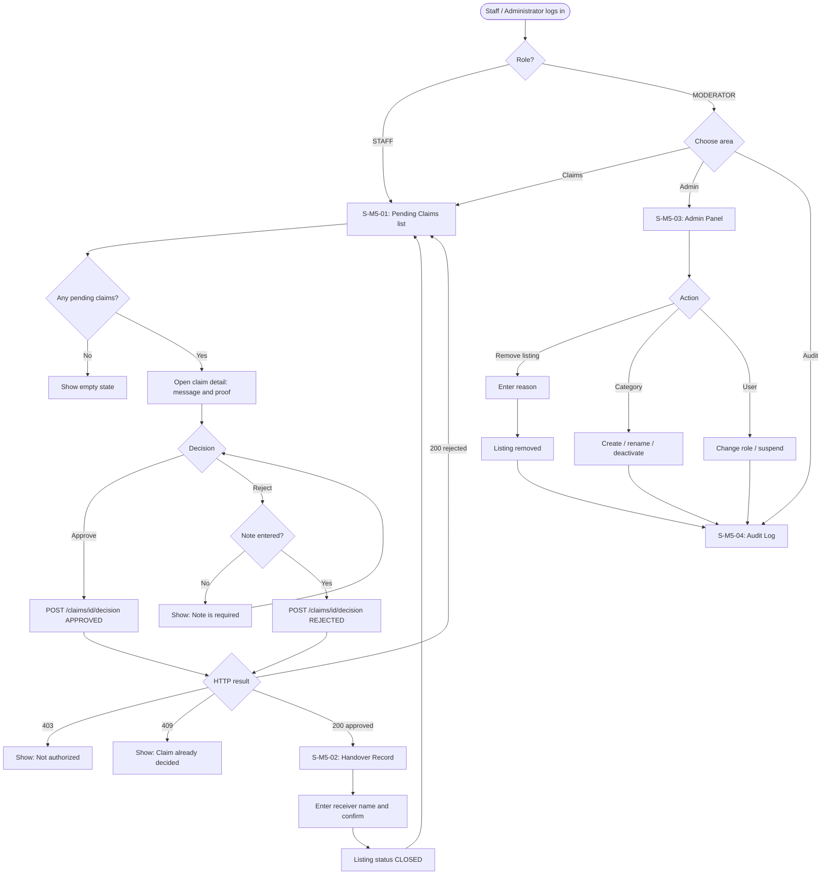

# Module 5 (M5) — User Flow & Interface Specifications

**Module Owner:** Berra Bayındır (K5 — DevOps Engineer)  
**Target Screens:** Staff Claim Review, Handover Record, Admin Panel (listings / categories / users), Audit Log.

---

## 1. Screens

| Screen | Purpose | Main elements | Related FR |
|---|---|---|---|
| **S-M5-01 Staff Claim Review** | List pending claims and decide | Pending claims list, claim detail (message, proof), Approve / Reject buttons, note field | FR-M5-01 |
| **S-M5-02 Handover Record** | Record that the item was handed over | Receiver name field, date/time, Confirm button | FR-M5-02, FR-M5-03 |
| **S-M5-03 Admin Panel** | Moderate listings, categories and users | Tabs: Listings, Categories, Users; Remove with reason; role change; suspend | FR-M5-04, 05, 06 |
| **S-M5-04 Audit Log** | Show who changed what and when | Table: actor, time, action, target, before/after; filter | FR-M5-07 |

Error and empty states: no pending claims, 403 "You are not authorized", 409 "Claim already decided", validation message "Note is required for rejection".

---

## 2. User Flow Diagram (Mermaid)

---

## 3. Figma Frames and Prototype Connections

The frames are in the shared Figma file, page **M5 – Approval, Moderation, Audit** (link: see `docs/ux/figma-links.md`).

| Frame name in Figma | Screen | Clickable connection (prototype) |
|---|---|---|
| `M5-01 Claim Review` | S-M5-01 | "Approve" → `M5-02 Handover Record`; "Reject" → note dialog → back to list |
| `M5-02 Handover Record` | S-M5-02 | "Confirm" → `M5-01 Claim Review` |
| `M5-03 Admin Panel` | S-M5-03 | "Remove" → reason dialog → `M5-04 Audit Log` |
| `M5-04 Audit Log` | S-M5-04 | "Back" → `M5-03 Admin Panel` |

Every screen of the flow above must exist as a frame and be connected in prototype mode, so that the flow can be clicked from the first to the last screen.

---

## 4. Screenshots

Screenshots of the frames are stored in `docs/ux/screens/m5/` (for example `m5-01-claim-review.png`) and are listed in `docs/ux/figma-links.md`.
